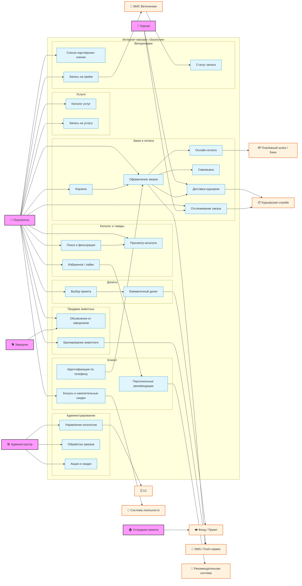

# Интернет-магазин «Зоология»

## Содержание

1. О проекте
2. Заказчик
3. Цели и задачи
4. Функциональные требования
5. Нефункциональные требования
6. Интеграции
7. Дорожная карта
8. Бюджет
9. UML-диаграмма
10. Сроки работы

---

## О проекте

Разработка интернет-магазина для сети зоомагазинов **«Зоология»** с перспективой развития в полноценную платформу. В целевой функционал входят:

- продажа кормов и зоотоваров;
- сбор донатов в приюты для животных;
- продажа породистых кошек и собак от заводчиков;
- запись в партнёрские ветеринарные клиники;
- услуги для животных (стрижка, выгул).

На старте реализуется **веб-сайт**; запуск начинается с продажи товаров, затем функционал наращивается поэтапно.

---

## Заказчик

| Параметр | Значение |
|---|---|
| Название сети | «Зоология» |
| Текущий регион | Дальний Восток (5 крупных городов) |
| Количество офлайн-точек | 20 магазинов |
| Стратегия развития | Выход на Центральную Россию через 2 года |
| Опыт онлайн-продаж | 6 месяцев (соцсети, включая мессенджеры) |
| Клиентская база | ~1 500 клиентов |
| Учётная система | 1С (в 20 магазинах) |

---

## Цели и задачи

- Запустить собственный интернет-магазин и перевести онлайн-продажи из соцсетей в управляемую платформу.
- Начать с продажи товаров для животных, затем нарастить функционал и перерасти в платформу.
- Масштабировать бизнес за пределы Дальнего Востока (выход в Центральную Россию через 2 года).
- Создать экосистему: товары + донаты + животные + ветклиники + услуги.
- Построить систему лояльности и персонализированных рекомендаций.

---

## Функциональные требования

### Модуль «Товары»
- Каталог товаров: корма для животных и сопутствующие товары (поводки, шлейки и т. д.).
- Корзина и оформление заказа.
- Онлайн-оплата — единственный способ оплаты.
- Получение заказа: **самовывоз** из магазина или **доставка курьером** (интеграция с курьерской службой).

### Модуль «Донаты»
- Донаты для приютов: раз в месяц деньги перечисляются на выбранный пользователем приют.

### Модуль «Продажа животных»
- Объявления о продаже породистых животных от заводчиков (кошки и собаки).

### Модуль «Ветеринарные клиники»
- Запись в партнёрские ветеринарные клиники.

### Модуль «Услуги для животных»
- Запись на услуги: стрижка, выгул и т. п.

### Модуль «Клиент»
- Идентификация клиента по номеру телефона.
- Система лояльности (накопительные скидки и др.).
- Уведомления: **push и SMS**.
- Рекомендательная система: фиксируются действия пользователя (покупки, лайки) для формирования рекомендаций.

---

## Нефункциональные требования

| Требование | Описание |
|---|---|
| Платформа | Веб-сайт |
| Оплата | Только онлайн |
| Инфраструктура | Облачные серверы (собственных мощностей для поддержки сайта нет) |
| Масштабируемость | Обязательна (с учётом планов выхода в Центральную Россию) |
| Надёжность | Высокая |

---

## Интеграции

- **1С** — выгрузка каталога товаров из учётной системы 20 магазинов.
- **Курьерская служба** — для доставки заказов.
- **Платёжный шлюз** — онлайн-оплата.
- **Сервисы уведомлений** — push и SMS.

---

## Дорожная карта

Реализация всего функционала рассчитана на **2 года**.

| Этап | Срок | Функционал |
|---|---|---|
| **1** | 0–3 мес. | Продажа товаров |
| **2** | 3–6 мес. | Донаты в приюты, продажа породистых животных |
| **3** | ~12 мес. | Запись в ветеринарные клиники |
| **4** | ~18 мес. | Услуги для животных (стрижка, выгул) |
| **5** | 2 года | Выход на Центральную Россию, развитие платформы |

---

## Бюджет

**15–20 млн ₽** на весь проект в течение **2 лет**.

---

## UML-диаграмма

---

## Сроки работы

> Дата начала проекта: **10 октября 2026**  
> Плановая длительность: **10 октября 2028**